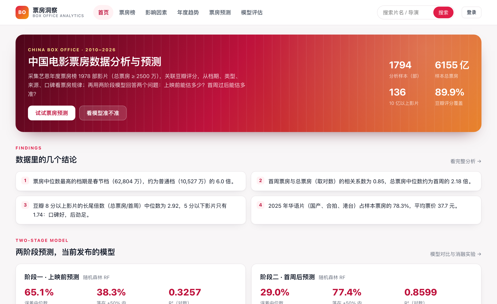
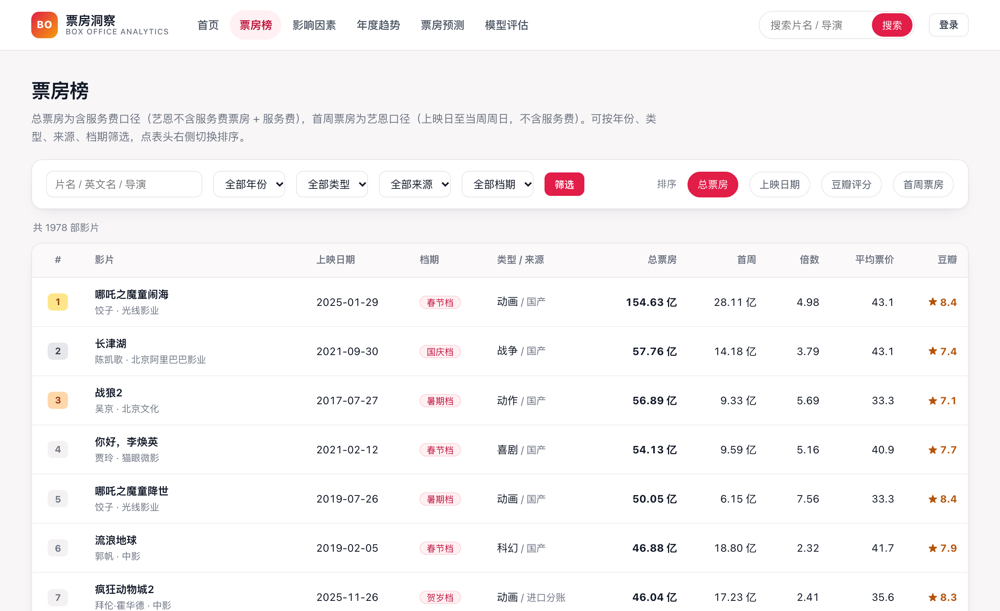
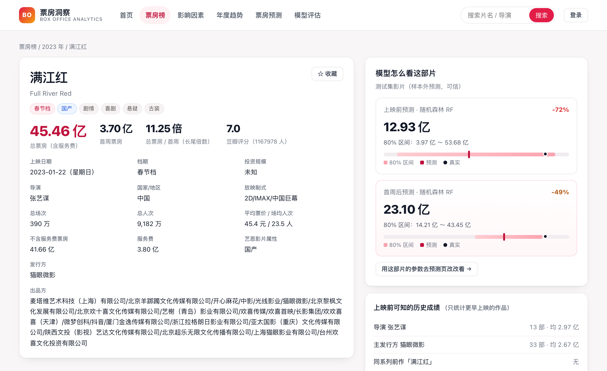
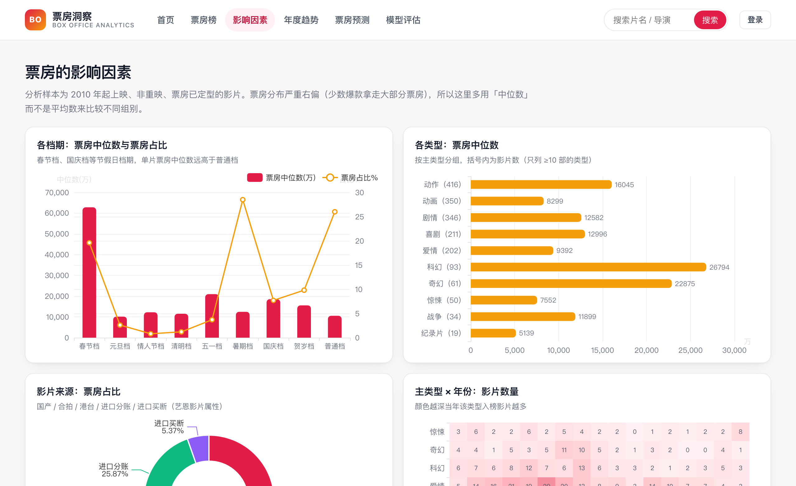
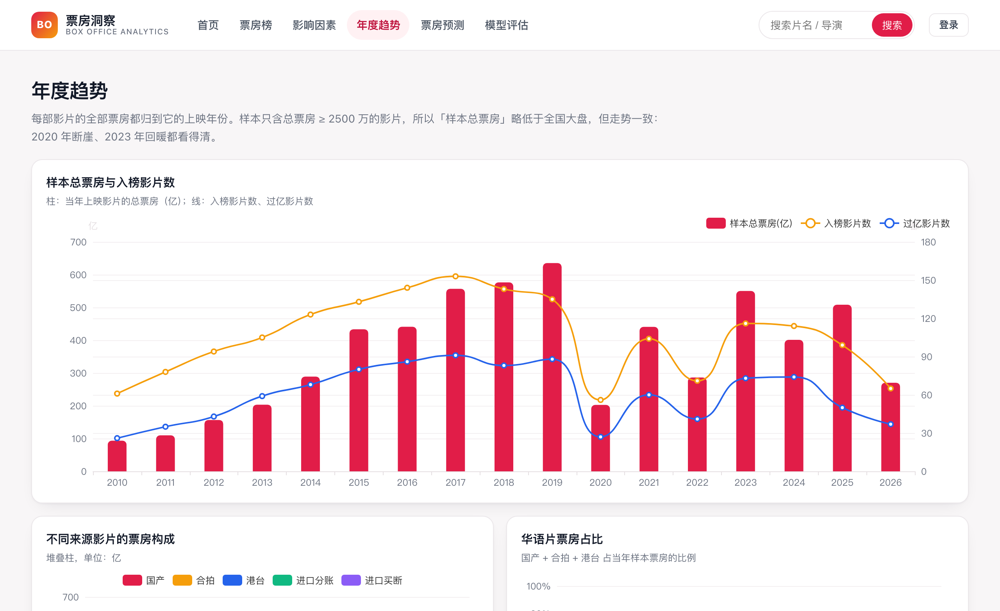
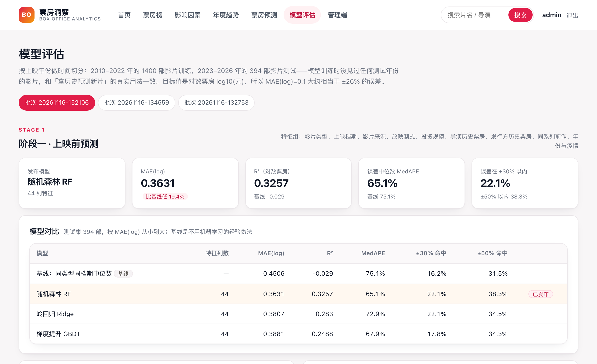
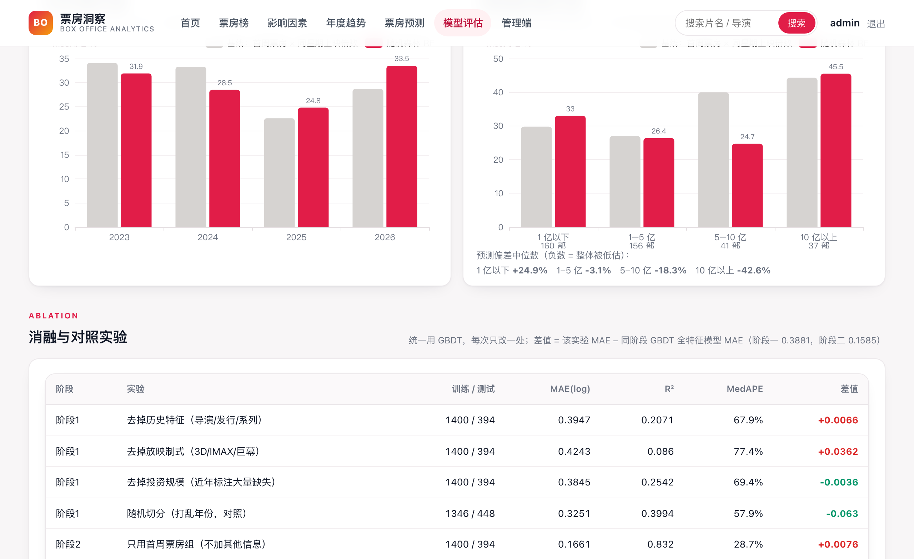
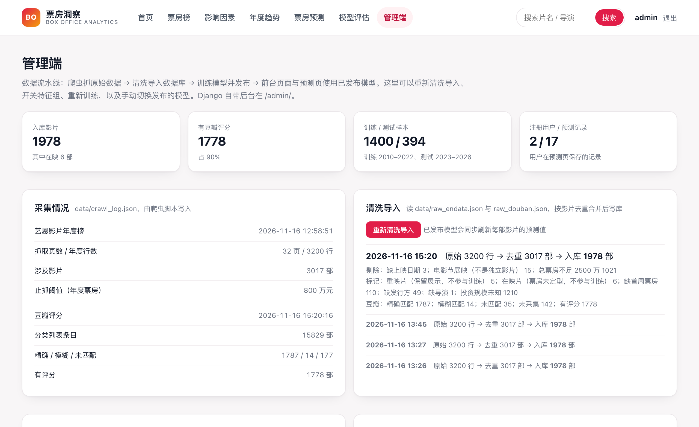

# 038 基于 Django 的电影票房数据分析与预测系统-设计展示

> **代码有偿获取 可接受定制 微信联系方式: csbysj2020 或 ACE2487，备注(BS)**

> **完整源码与全套文档 · 在线自助获取 >>> [https://mbd.pub/o/bread/YZaWl5ptZQ==](https://mbd.pub/o/bread/YZaWl5ptZQ==)**

> **成品页（功能介绍 / 更多选题）>>> [https://bishe.suilang.net/products/boxoffice-insight](https://bishe.suilang.net/products/boxoffice-insight)**

> 

> 

## 视频

> **点击查看 >>> [https://www.bilibili.com/video/BV1q4sP6qEUD/](https://www.bilibili.com/video/BV1q4sP6qEUD/)**

## 项目简介

同一部片分两个时间点预测：上映前只看类型、档期、主创过往成绩，首周后再加首周票房与口碑。真实抓取艺恩娱数 1978 部影片（2010–2026 年，合计 6155 亿元）并匹配豆瓣评分，按年份切分评估（2010–2022 训练、2023–2026 测试）。上映前误差中位数 65%，首周后降到 29%，模型在哪些年份、哪些量级上不如基线都如实写进论文。

电影票房呈极端的长尾分布，少数影片拿走大部分票房，而大多数影片的票房集中在一两亿以内。

片方和影院需要在两个时间点做决定：上映前定宣发预算与排片，上映首周后决定是否追加。

现有的票房预测课程设计多采用随机切分，并把评分人数、总场次等「结果信息」当作特征，测得的精度往往远高于实际可用的水平。

本仓库为**设计展示**：包含项目说明、技术架构、实验结果与运行截图；完整源码、任务书、开题报告、毕业论文与使用说明可通过上方链接自助获取，成品页可查看更多选题，也可联系微信咨询定制。

## 功能特性

1. 真实数据：艺恩娱数年度影片榜 1978 部（总票房 ≥ 2500 万）+ 豆瓣评分匹配 1801 部，两个采集器都只用公开接口

2. 清洗规则全脚本化：跨年影片合并、展映剔除、重映与在映识别、服务费口径还原，清洗日志可在管理端查看

3. 两阶段预测：阶段一（上映前）随机森林 RF MAE(log) 0.363 vs 基线 0.451；阶段二（首周后）随机森林 RF 0.156 vs 基线 0.194

4. 防泄露：导演 / 发行方 / 系列历史成绩只用上映日之前的影片；评分人数、总场次等累积字段不进主模型

5. 三种算法对比：岭回归、随机森林、梯度提升，各自对比「同类型同档期中位数」与「首周 × 倍数」两条基线

6. 消融与对照：随机切分 MAE 0.325（偏乐观）、加入泄露特征 R² 0.980（虚高），逐组去特征看贡献

7. 预测页：同时给出两阶段预测与 80%% 区间（测试集残差分位），附历史成绩与票房量级相近的同类影片

8. 评估页：模型对比表、预测 vs 实际散点、特征重要性、分年份 / 分量级误差、消融实验

9. 分析页：春节档票房中位数约为普通档 6.0 倍；类型、来源、豆瓣评分、发行方与导演 Top 10、年度趋势

10. 三种角色：访客浏览、普通用户收藏与预测、管理员在管理端重新导入 / 开关特征组 / 训练 / 发布模型

11. 数字单一来源：页面与论文都读 data/stats.json，重跑 export_stats.py 即可同步

## 技术架构

| 项目 | 说明 |
| --- | --- |
| 编程语言 | Python 3.8 及以上 |
| Web 框架 | Django 4.2（默认 SQLite，免装数据库） |
| 机器学习 | scikit-learn（Ridge / RandomForest / GradientBoosting） |
| 采集 | requests（艺恩娱数公开接口 + 豆瓣移动端接口） |
| 前端 | 原生 HTML/CSS/JS + ECharts 5（本地引入） |
| 样本规模 | 1978 部影片 / 2010–2026 年 |
| 运行端口 | http://127.0.0.1:8000 |
| 演示账号 | admin / boxoffice2026（管理员）、demo / demo123456（普通用户） |

## 目录结构

以下为完整交付版的结构（本仓库仅作设计展示）：

```
boxoffice-insight/
├── 任务书/
│   └── 毕业设计任务书.docx
├── 开题报告/
│   └── 毕业设计开题报告.docx
├── 最终论文/
│   ├── 图/
│   │   ├── fig-ablation.png
│   │   ├── fig-arch.png
│   │   ├── fig-decay.png
│   │   ├── fig-douban.png
│   │   ├── fig-funnel.png
│   │   ├── fig-importance.png
│   │   ├── fig-models.png
│   │   ├── fig-scatter.png
│   │   ├── fig-season.png
│   │   └── fig-year.png
│   └── 基于Django的电影票房数据分析与预测系统设计与实现.docx
├── 源码/
│   ├── analytics/
│   │   ├── __init__.py
│   │   ├── apps.py
│   │   ├── stats.py
│   │   └── views.py
│   ├── boxoffice/
│   │   ├── __init__.py
│   │   ├── asgi.py
│   │   ├── settings.py
│   │   ├── urls.py
│   │   └── wsgi.py
│   ├── console/
│   │   ├── __init__.py
│   │   ├── apps.py
│   │   └── views.py
│   ├── crawler/
│   │   ├── douban.py
│   │   └── endata.py
│   ├── data/
│   │   ├── models/
│   │   ├── crawl_log.json
│   │   ├── raw_douban.json
│   │   ├── raw_douban_list.json
│   │   ├── raw_endata.json
│   │   └── …
│   └── …
└── …
```

## 数据与实验结论

- 本项目以艺恩娱数的年度影片票房榜为主数据源，补充豆瓣评分，整理出 2010–2026 年总票房不低于 2500 万的 1,978 部影片（样本总票房 6,154.95 亿元）。
- 目标变量取总票房的常用对数，对比岭回归、随机森林与梯度提升三种模型，并分别设置简单基线；评估按上映年份切分，2010–2022 年的 1,400 部影片训练，2023–2026 年的 394 部影片测试。
- 实验结果表明：阶段一最优模型（随机森林 RF）的对数平均绝对误差为 0.3631，比基线降低 19.4%，但误差中位数仍有 65.1%，只有 22.1% 的影片落在真实票房 ±30% 以内——上映前只能判断票房量级；阶段二最优模型（随机森林 RF）的对数平均绝对误差降到 0.1558，R² 为 0.860，±30% 命中率 51.8%。
- 对照实验显示，把切分方式换成随机切分，阶段一误差会虚降 0.063；加入评分人数与总场次两个泄露特征，阶段二误差会虚降 0.101，说明切分方式与特征口径对结论的影响不亚于模型本身。
- 系统基于 Django 4.2 与 SQLite 实现，提供票房榜与检索、影片详情、影响因素分析、年度趋势、两阶段预测、模型评估与管理端七个模块，管理端可以开关特征组、重新训练并发布模型。

## 交付内容

1. 完整源码（两个采集器 + Django 工程 + 特征工程与训练评估模块 + scripts）
2. 抓好的真实数据（艺恩 3200 行原始数据 + 豆瓣列表与匹配结果）与训练好的模型文件
3. 一键启动脚本（macOS / Windows），首次运行自动导入、训练、建账号
4. 毕业设计任务书（Word）、开题报告（Word）
5. 毕业论文（Word，八章制，含模型对比、消融实验与误差分析）
6. 系统使用与二次开发说明（Word + md，12 节）
7. 12 张界面截图、论文配图、封面

## 常见问题

**数据是爬的吗？能更新吗？**

是。crawler/endata.py 调艺恩娱数年度影片榜的公开接口（不需登录），crawler/douban.py 调豆瓣移动端「选电影」列表与搜索接口补评分；重跑两个采集器再 import_films、train_models 即可更新。

**票房为什么和艺恩页面上的数字不一样？**

艺恩接口里的票房不含服务费，系统把服务费加回去，与新闻口径一致；首周票房保持艺恩口径（上映日至当周周日）。

**上映前预测准吗？**

不太准，这是行业真实难度：误差中位数约 65%，80% 区间很宽。首周后降到约 29%。论文第 7 章把模型输给基线的年份和量级都列出来了，答辩讲这一点比堆指标更有说服力。

**为什么按年份切分，不随机切？**

预测的是未来上映的片，用过去训练、未来测试才符合实际；随机切分会把同一时期的市场信息泄露进训练集，消融实验里随机切分的误差明显偏低。

**能换成 MySQL 吗？**

能。设环境变量 DB_ENGINE=mysql 及 DB_NAME / DB_USER / DB_PASSWORD 后 migrate 即可，默认 SQLite 免安装。

**想加特征或换模型改哪里？**

特征组在 predictor/features.py 的 GROUPS，算法在 predictor/training.py 的 ALGOS，加一行就多一个对比；数据口径（入库门槛、训练 / 测试年份）集中在 settings.py 的 BOX_OFFICE_RULES。

## 截图










